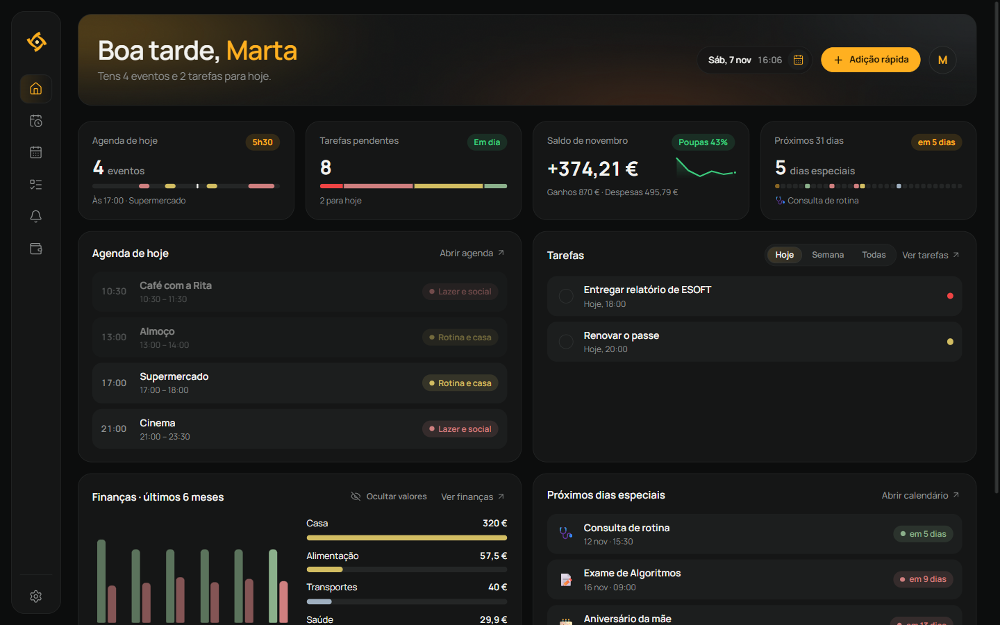
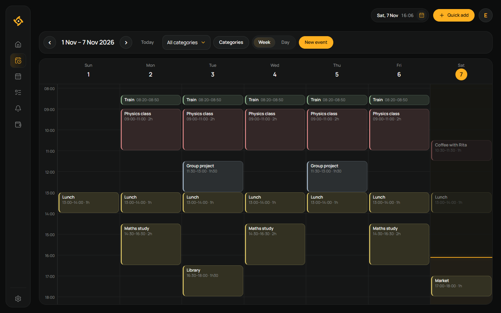
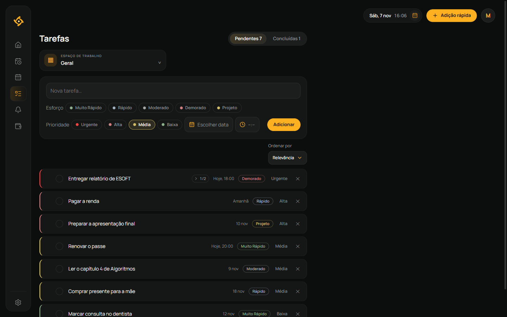
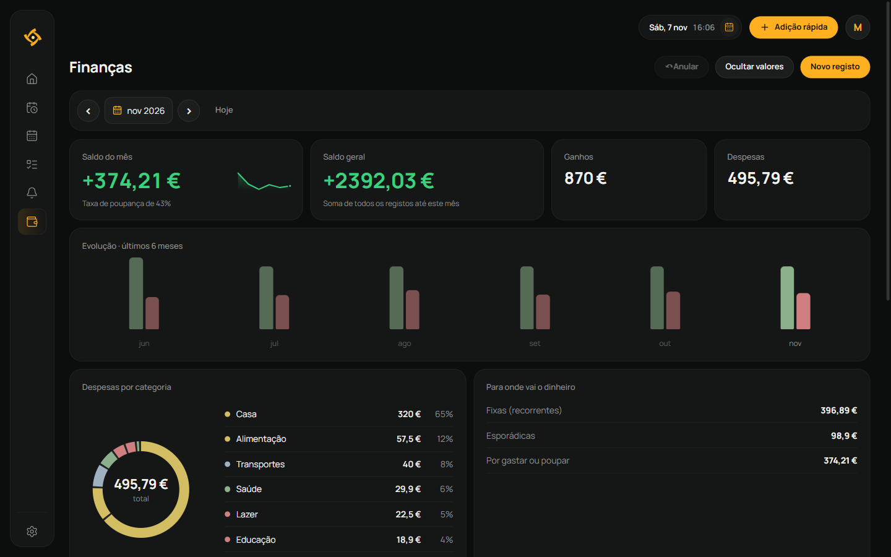
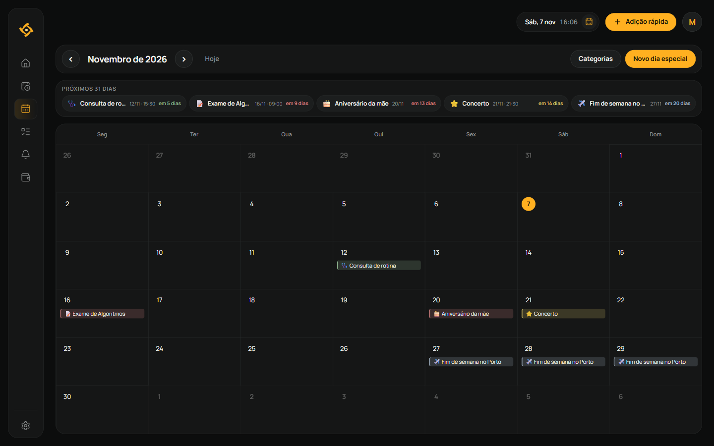
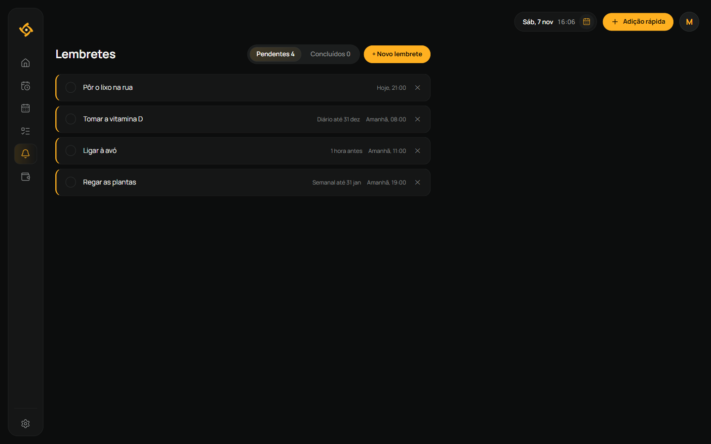
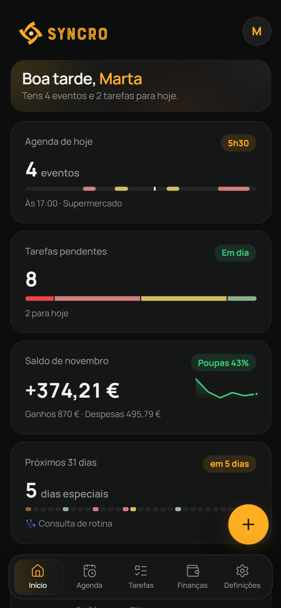
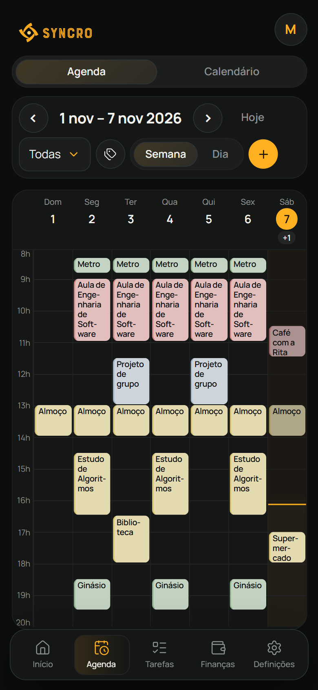
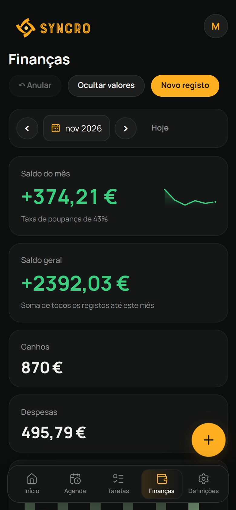

  

<h1 align="center">Syncro</h1>

  <strong>Agenda, calendário, tarefas, lembretes e finanças num só lugar.</strong> 
  No computador e no telemóvel, sempre sincronizado.

  
  
  

  <a href="https://github.com/TAKO-77/SyncroApp/releases/latest/download/SyncroSetup.exe"><strong>Descarregar para Windows</strong></a>
  &nbsp;·&nbsp;
  <a href="https://app.getsyncro.workers.dev"><strong>Abrir no browser</strong></a>
  &nbsp;·&nbsp;
  <a href="#telemóvel"><strong>Instalar no telemóvel</strong></a>

  <picture>
    <source media="(prefers-color-scheme: light)" srcset="docs/images/inicio-light.png">
    
  </picture>

## Porquê o Syncro

- **Tudo num ecrã.** O Início resume o dia: eventos, tarefas, saldo do mês e datas importantes.
- **Funciona sem Internet.** As alterações aparecem de imediato e sincronizam quando houver ligação.
- **Em todos os dispositivos.** Aplicação para Windows e app web instalável no Android e no iPhone, com a mesma conta.
- **Avisa a tempo.** Notificações das tarefas com hora limite e dos lembretes, no computador e no telemóvel.
- **Em português, inglês, alemão e francês**, com modo claro e escuro, atalhos de teclado e adição rápida em linguagem natural no idioma escolhido (`/` ou `Ctrl+K`).

## Funcionalidades

### Agenda

Planeamento diário e semanal, com categorias coloridas, eventos recorrentes e eventos que atravessam a meia-noite. O horário de sono de cada dia da semana aparece na grelha e edita-se diretamente na Agenda.

### Tarefas

Prioridades, esforço estimado, data e hora limite, subtarefas e espaços de trabalho com notas próprias. Cada espaço de trabalho pode ter a sua ordenação.

### Finanças

Receitas e despesas, movimentos recorrentes, saldo do mês e saldo geral, evolução dos últimos seis meses e despesas por categoria.

<table>
  <tr>
    <td width="50%" valign="top">
      <h3>Calendário</h3>
      
Aniversários, exames, consultas e viagens, com a lista do que aí vem nos próximos 31 dias.

      
    </td>
    <td width="50%" valign="top">
      <h3>Lembretes</h3>
      
Lembretes únicos, com aviso antecipado, ou repetidos todos os dias ou todas as semanas.

      
    </td>
  </tr>
</table>

### No telemóvel

  
  &nbsp;
  
  &nbsp;
  

Em ecrãs pequenos, a navegação passa para uma barra no fundo e Agenda/Calendário e Tarefas/Lembretes partilham o mesmo separador.

> As imagens usam dados de demonstração.

## Instalar

### Windows

1. Abre a [versão mais recente](https://github.com/TAKO-77/SyncroApp/releases/latest).
2. Descarrega e executa **SyncroSetup.exe**.
3. Abre o Syncro pelo menu Iniciar ou pelo atalho criado durante a instalação.

A aplicação requer o Microsoft Edge WebView2 Runtime. O instalador verifica se está disponível e indica como o instalar, caso seja necessário.

### Telemóvel

O Syncro também pode ser instalado como app web (PWA) a partir de [app.getsyncro.workers.dev](https://app.getsyncro.workers.dev):

- **Android (Chrome):** abre o endereço e escolhe **⋮ → Instalar app**.
- **iPhone (Safari):** abre o endereço e escolhe **Partilhar → Adicionar ao ecrã principal**. As notificações no iPhone só funcionam com a app instalada desta forma.

A app web abre sem ligação com os dados guardados no dispositivo e sincroniza com a mesma conta da aplicação Windows.

## Atalhos

| Tecla | Ação |
| --- | --- |
| `1` a `8` | Início, Agenda, Calendário, Tarefas, Lembretes, Finanças, Perfil e Definições |
| `/` ou `Ctrl+K` | Adição rápida |
| `←` `→` | Período anterior ou seguinte na Agenda, no Calendário e nas Finanças |
| `↑` `↓` | Deslocar a grelha da Agenda ou a página |

## Dados e cópias de segurança

É necessário iniciar sessão com uma conta (email e palavra-passe). Os dados de cada conta são guardados no Supabase e mantidos em cache no computador: as alterações aparecem de imediato, são enviadas em segundo plano e continuam guardadas localmente se não houver ligação à Internet. O primeiro início de sessão num computador precisa de ligação.

No primeiro início de sessão, os dados guardados neste computador antes das contas são enviados para a conta, se esta estiver vazia. Se a conta já tiver dados, o Syncro pergunta se queres juntá-los, manter só os da conta ou substituí-los pelos do computador.

Em **Definições → Conta**, podes ver o estado da sincronização, sincronizar manualmente e terminar sessão. Em **Definições → Dados e cópia de segurança**, podes exportar um ficheiro JSON ou importar uma cópia anterior. Em **Definições → Idioma**, escolhes o idioma da app; a escolha fica na conta e aplica-se a todos os dispositivos e às notificações.

O instalador preserva os dados durante as atualizações. Ao desinstalar, podes escolher se pretendes eliminá-los.

## Atualizações

Ao iniciar, o Syncro verifica se existe uma versão mais recente publicada neste repositório. Quando encontra uma atualização, pergunta se queres descarregar e executar o instalador. A aplicação continua a funcionar se não houver ligação à Internet ou se a verificação falhar.

Em **Definições → Atualizações**, podes consultar a versão instalada, procurar atualizações manualmente e abrir a página de releases. A procura manual mostra o resultado e eventuais erros. A app só fecha depois de descarregar, validar e conseguir abrir o instalador, que reutiliza a pasta de instalação atual.

O atualizador usa apenas releases públicas estáveis, com tag numérica (`v2.3.2` ou `V2.3.2`) e um anexo chamado **SyncroSetup.exe**. Confirma o tamanho do download e, quando fornecido pelo GitHub, o SHA-256. As falhas ficam registadas em `%LOCALAPPDATA%\Syncro\updates.log`.

Na app web, quando é publicada uma versão nova aparece o aviso **Nova versão disponível**; a versão nova só é aplicada quando escolhes **Recarregar**.

**Versões 2.3.0 e 2.3.1:** têm um erro na leitura dos anexos da release. É necessário descarregar e instalar manualmente a versão 2.3.2 uma vez, por cima da instalação existente, sem desinstalar. As atualizações futuras passam a usar o atualizador corrigido.

---

## Desenvolvimento

A interface usa React, TypeScript e Vite. O executável Windows usa WebView2. O aspeto visual segue `docs/DESIGN_SYSTEM.md`.

A compilação e os testes requerem Node.js 22.18 ou superior (suporte nativo a scripts TypeScript) e o .NET Framework do Windows. O instalador é compilado com Inno Setup.

## Publicar uma versão

A versão preparada é **2.11.0**. Para publicar uma atualização:

1. Define o mesmo novo número em `desktop/Program.cs` (`AppVersion`), `desktop/installer/Syncro.iss` (`AppVersion`) e `codigo-fonte/package.json` (`version`), que é a versão mostrada na aplicação web.
2. Fecha o Syncro e executa `scripts/build.bat`.
3. Abre `desktop/installer/Syncro.iss` no Inno Setup e compila o instalador. O resultado fica em `releases/SyncroSetup.exe`.
4. Faz commit e push do código e da documentação. Exclui dependências instaladas, ficheiros temporários e atalhos locais. Os ficheiros gerados são distribuídos no instalador da Release.
5. Cria uma GitHub Release a partir do commit enviado, com uma tag correspondente à versão, por exemplo `v2.3.2`.
6. Anexa o **novo** `releases/SyncroSetup.exe`, com o nome exato **SyncroSetup.exe**, descreve as alterações e publica como **Latest**. Não marques como draft ou pre-release. Só enviar commits ou criar uma tag não disponibiliza o instalador à app.

O número da tag deve coincidir com a versão do executável e do instalador para que a deteção de atualizações funcione corretamente.

O Inno Setup recusa compilar se a versão do executável for diferente da declarada no instalador, evitando publicar um instalador com um executável antigo. Antes de publicar, confirma a instalação por cima de uma versão anterior e a opção **Procurar atualizações**. Na release 2.3.2, indica que a instalação manual inicial é necessária para quem usa 2.3.0/2.3.1.
