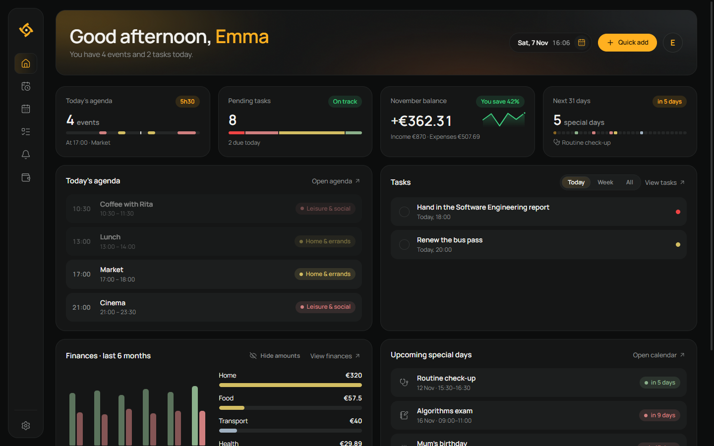
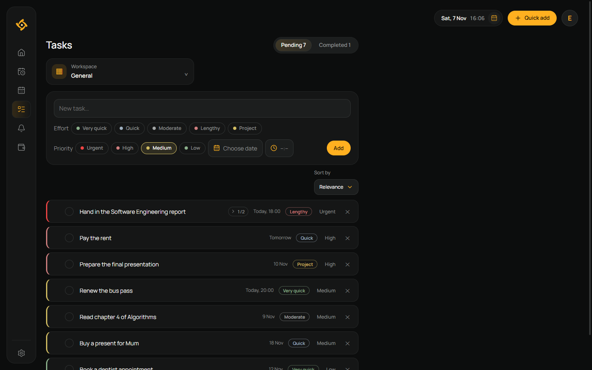
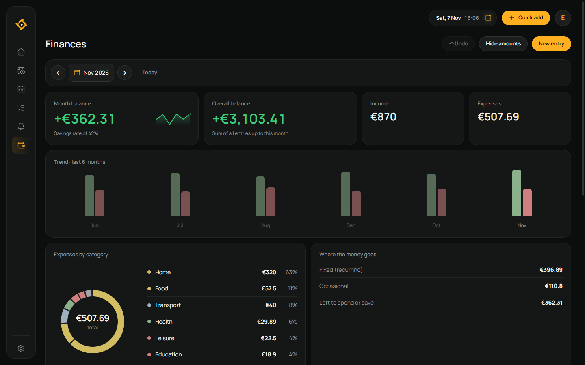
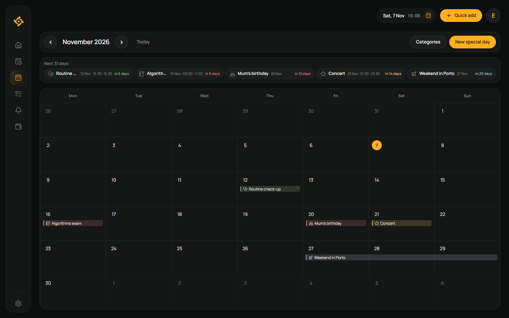
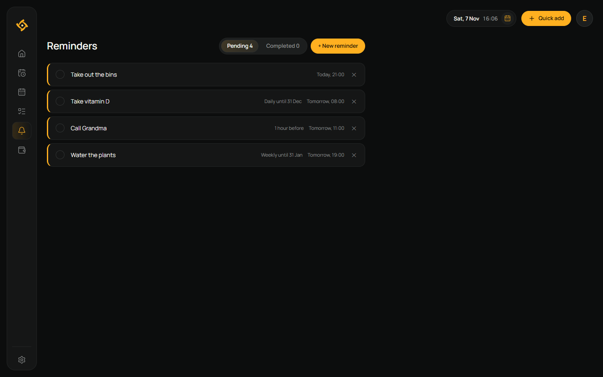
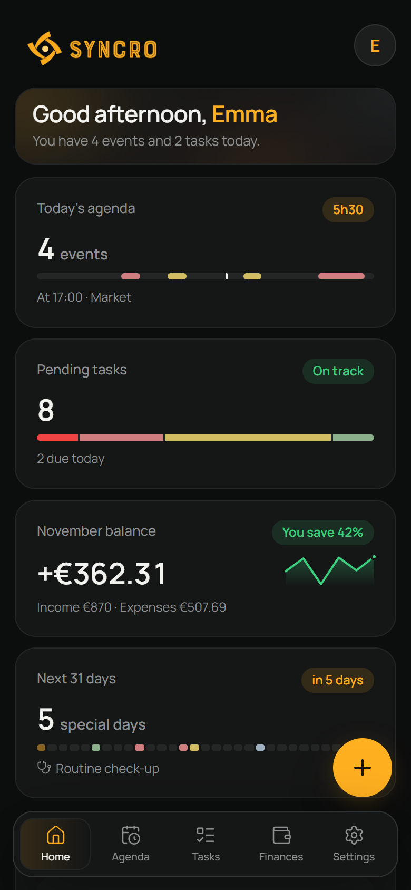
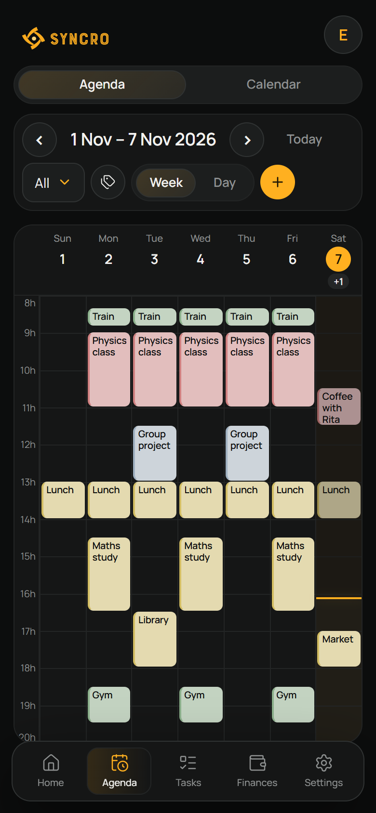
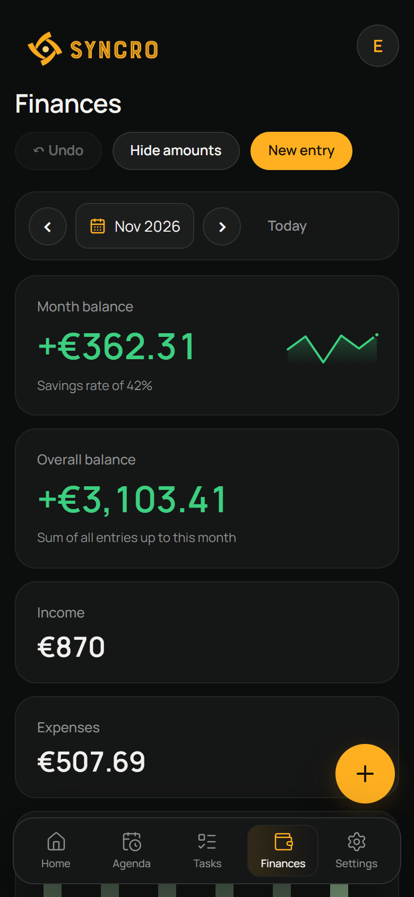

  

<h1 align="center">Syncro</h1>

  <strong>Agenda, calendar, tasks, reminders and finances in one place.</strong> 
  On your computer and your phone, always in sync.

  
  
  

  <a href="https://github.com/TAKO-77/SyncroApp/releases/latest/download/SyncroSetup.exe"><strong>Download for Windows</strong></a>
  &nbsp;·&nbsp;
  <a href="https://app.getsyncro.workers.dev"><strong>Open in the browser</strong></a>
  &nbsp;·&nbsp;
  <a href="#phone"><strong>Install on your phone</strong></a>

  <picture>
    <source media="(prefers-color-scheme: light)" srcset="docs/images/home-light.png">
    
  </picture>

## Why Syncro

- **Everything on one screen.** Home sums up your day: events, tasks, the month's balance and important dates.
- **Works offline.** Changes show up at once and sync when there is a connection.
- **On every device.** A Windows app and a web app you can install on Android and iPhone, with the same account.
- **Reminds you in time.** Notifications for tasks with a time limit and for reminders, on your computer and your phone.
- **In English, Portuguese, German and French**, with light and dark modes, keyboard shortcuts and natural-language quick add in the chosen language (`/` or `Ctrl+K`).

## Features

### Agenda

Daily and weekly planning, with coloured categories, recurring events and events that run past midnight. Each weekday's sleep schedule appears on the grid and is edited right in the Agenda.

### Tasks

Priorities, estimated effort, due date and time, subtasks, and workspaces with their own notes. Each workspace can have its own sort order.

### Finances

Income and expenses, recurring entries, the month's and overall balance, the last six months at a glance and spending by category.

<table>
  <tr>
    <td width="50%" valign="top">
      <h3>Calendar</h3>
      
Birthdays, exams, appointments and trips, with a list of what is coming up in the next 31 days.

      
    </td>
    <td width="50%" valign="top">
      <h3>Reminders</h3>
      
One-off reminders with an early warning, or reminders repeated every day or every week.

      
    </td>
  </tr>
</table>

### Phone

  
  &nbsp;
  
  &nbsp;
  

On small screens, navigation moves to a bar at the bottom, and Agenda/Calendar and Tasks/Reminders share one tab each.

> The screenshots use demo data.

## Install

### Windows

1. Open the [latest version](https://github.com/TAKO-77/SyncroApp/releases/latest).
2. Download and run **SyncroSetup.exe**.
3. Open Syncro from the Start menu or the shortcut created during setup.

The app needs the Microsoft Edge WebView2 Runtime. The installer checks whether it is available and tells you how to install it if needed.

### Phone

Syncro can also be installed as a web app (PWA) from [app.getsyncro.workers.dev](https://app.getsyncro.workers.dev):

- **Android (Chrome):** open the address and choose **⋮ → Install app**.
- **iPhone (Safari):** open the address and choose **Share → Add to Home Screen**. Notifications on iPhone only work with the app installed this way.

The web app opens offline with the data saved on the device and syncs with the same account as the Windows app.

## Shortcuts

| Key | Action |
| --- | --- |
| `1` to `8` | Home, Agenda, Calendar, Tasks, Reminders, Finances, Profile and Settings |
| `/` or `Ctrl+K` | Quick add |
| `←` `→` | Previous or next period in the Agenda, Calendar and Finances |
| `↑` `↓` | Scroll the Agenda grid or the page |

## Data and backups

You need to sign in with an account (email and password). Each account's data is stored in Supabase and cached on the computer: changes show up at once, are sent in the background and stay saved locally when there is no Internet connection. The first sign-in on a computer needs a connection.

On the first sign-in, data saved on this computer before accounts existed is uploaded to the account if the account is empty. If the account already has data, Syncro asks whether to merge them, keep only the account's data or replace it with the computer's.

In **Settings → Account** you can see the sync status, sync manually and sign out. In **Settings → Data and backup** you can export a JSON file or import an earlier backup. In **Settings → Language** you choose the app's language; the choice is saved in your account and applies to all your devices and to notifications.

The installer keeps your data during updates. When uninstalling, you can choose whether to delete it.

## Updates

On start-up, Syncro checks whether a newer version has been published in this repository. When it finds one, it asks whether to download and run the installer. The app keeps working when there is no Internet connection or the check fails.

In **Settings → Updates** you can see the installed version, check for updates manually and open the releases page. A manual check shows its result and any errors. The app only closes after it has downloaded, verified and opened the installer, which reuses the current installation folder.

The updater only uses stable public releases with a numeric tag (`v2.3.2` or `V2.3.2`) and an asset named **SyncroSetup.exe**. It checks the download size and, when GitHub provides it, the SHA-256. Failures are logged in `%LOCALAPPDATA%\Syncro\updates.log`.

In the web app, a **New version available** notice appears when a new version is published; it is only applied when you choose **Update**.

**Versions 2.3.0 and 2.3.1** have a bug reading release assets. Download and install version 2.3.2 manually once, over the existing installation, without uninstalling. Later updates then use the fixed updater.

---

## Development

The UI uses React, TypeScript and Vite. The Windows executable uses WebView2. The visual design follows `docs/DESIGN_SYSTEM.md`.

Building and testing need Node.js 22.18 or later (native TypeScript scripts) and the Windows .NET Framework. The installer is built with Inno Setup.

## Publishing a version

The prepared version is **2.11.0**. To publish an update:

1. Set the same new number in `desktop/Program.cs` (`AppVersion`), `desktop/installer/Syncro.iss` (`AppVersion`) and `codigo-fonte/package.json` (`version`), which is the version shown in the web app.
2. Quit Syncro and run `scripts/build.bat`.
3. Open `desktop/installer/Syncro.iss` in Inno Setup and compile the installer. The result is `releases/SyncroSetup.exe`.
4. Commit and push the code and documentation. Leave out installed dependencies, temporary files and local shortcuts. Generated files are shipped in the release installer.
5. Create a GitHub Release from the pushed commit, with a tag matching the version, for example `v2.3.2`.
6. Attach the **new** `releases/SyncroSetup.exe`, named exactly **SyncroSetup.exe**, describe the changes and publish it as **Latest**. Do not mark it as a draft or pre-release. Pushing commits or creating a tag alone does not make the installer available to the app.

The tag number must match the version of the executable and the installer for update detection to work.

Inno Setup refuses to compile if the executable's version differs from the one declared in the installer, so an installer with an old executable cannot be published. Before publishing, check installing over an earlier version and the **Check for updates** option. The 2.3.2 release notes must say that a one-time manual install is needed for users of 2.3.0/2.3.1.
